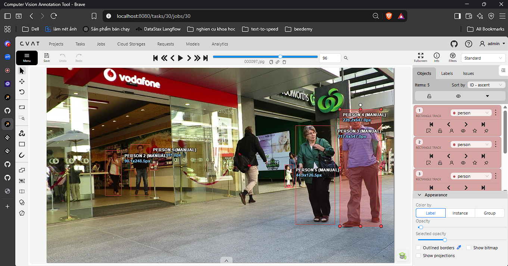
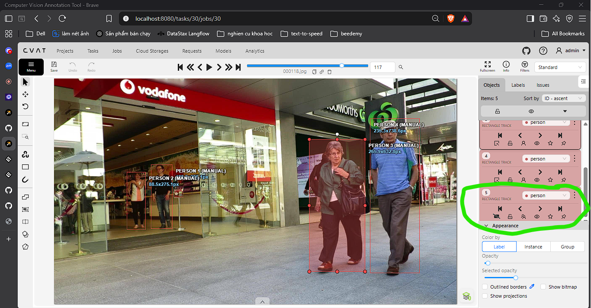
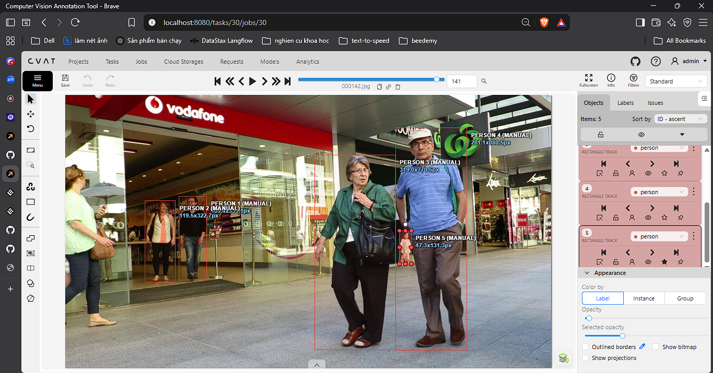

# Báo cáo cá nhân — Nguyễn Văn Hùng — 202603097

Đoạn video: MOT17-09, 150 frame (frame 1–150), nguồn MOTChallenge, giấy phép CC BY-NC-SA 3.0.

## 0. Thông tin học viên

- Họ tên: Nguyễn Văn Hùng.
- MSSV: 202603097.
- Mã đề (A/B/C): A.
- Email: hunghocweb2709@gmail.com.
- Link repository: https://github.com/hunghocweb/K5-L2-DAY05-NguyenVanHung-2A202603097-MOTTracking
- Giờ bắt đầu: 16:00.
- Giờ kết thúc: 19:30.

## 1. Xem trước đoạn video (CP0)

Ghi **trước khi vẽ**, mỗi người một dòng.

| Mã  | Frame xuất hiện | Frame cuối thấy được | Rẽ / dừng / đổi tốc độ ở frame | Bị che ở frame                                   | Ghi chú                                 |
| --- | --------------- | -------------------- | ------------------------------ | ------------------------------------------------ | --------------------------------------- |
| P1  | 0 theo nhãn     | 149 theo nhãn        | Chưa có ghi chép               | `occluded`: 26–54                                | Không có đoạn `outside` trong file xuất |
| P2  | 61 theo nhãn    | 149 theo nhãn        | Chưa có ghi chép               | `occluded`: 61–71                                | không có ghi chú                        |
| P3  | 0 theo nhãn     | 149 theo nhãn        | Chưa có ghi chép               | Không có cờ `occluded`                           | không có ghi chú                        |
| P4  | 40 theo nhãn    | 149 theo nhãn        | Chưa có ghi chép               | Không có cờ `occluded`                           | không có ghi chú                        |
| P5  | 0 theo nhãn     | 147 theo nhãn        | Chưa có ghi chép               | `occluded` khi có box: 105–110, 135–140, 142–147 | `outside`: 111–134 và 148–149           |

## 2. Keyframe và thời gian (CP1, CP4)

Số keyframe lấy từ kết quả `src/check_submission.py`.

Khoảng thời gian từ bắt đầu đến kết thúc: 16:00–19:30 = 3 giờ 30 phút (210 phút).

| Mã       | Số keyframe | Keyframe ở frame                                                                    | Số frame có mặt | Keyframe / 100 frame | Thời gian (phút)    | Chỗ khó                                                               |
| -------- | ----------- | ----------------------------------------------------------------------------------- | --------------- | -------------------- | ------------------- | --------------------------------------------------------------------- |
| P1       | 20          | 0, 10, 20, 26, 30, 40, 50, 52, 55, 60, 70, 77, 80, 90, 100, 110, 120, 130, 140, 149 | 150             | 13,3                 | Chưa ghi            | Có cờ che một phần ở 26–54; lý do đặt keyframe cần học viên bổ sung   |
| P2       | 11          | 61, 71, 72, 81, 91, 101, 111, 121, 131, 141, 149                                    | 89              | 12,4                 | Chưa ghi            | Có cờ che một phần ở 61–71; chỗ khó thực tế chưa ghi                  |
| P3       | 18          | 0, 10, 20, 30, 40, 50, 60, 70, 80, 90, 100, 110, 120, 122, 125, 130, 140, 149       | 150             | 12,0                 | Chưa ghi            | Chưa có ghi chép                                                      |
| P4       | 12          | 40, 50, 60, 70, 80, 90, 100, 110, 120, 130, 140, 149                                | 110             | 10,9                 | Chưa ghi            | Chưa có ghi chép                                                      |
| P5       | 12          | 0, 10, 20, 30, 40, 50, 60, 105, 135, 140, 141, 142                                  | 124             | 9,7                  | Chưa ghi            | Có đoạn `outside` 111–134 và từ 148; lý do xử lý cần học viên bổ sung |
| **Tổng** | **73**      | —                                                                                   | **623**         | **11,7**             | **Chưa có dữ liệu** | —                                                                     |

Keyframe / 100 frame của cả bài = tổng keyframe ÷ tổng số frame có mặt × 100 = 73 ÷ 623 × 100 ≈ **11,7**.

Bạn đặt keyframe nhiều nhất ở người nào? Vì sao (người đó rẽ, dừng, lại gần camera hay bị che)?

P1 có nhiều keyframe nhất: 20. File xuất có keyframe tại mốc bật `occluded` 26 và tắt `occluded` 55. Lí do là person 1 xuất hiện và bị che nhiều lần trên khung hình và lúc đầu chưa quen nên chỉnh nhiều keyframe cho chắc.

## 3. Đoạn bị che (CP2)

Người được phân tích đoạn che khuất trong job thực tế: **P5** (CVAT track 4, MOT ID 3). P1 chưa bị che khuất hoàn toàn; đoạn mất hẳn rồi hiện lại thuộc P5. Các mốc dưới đây lấy từ file xuất, tính theo frame CVAT (bắt đầu từ 0).

| Mốc                                      | Frame |
| ---------------------------------------- | ----: |
| Bắt đầu bị che một phần (bật `occluded`) |   105 |
| Mất hẳn (bật `outside`)                  |   111 |
| Hiện lại (tắt `outside`)                 |   135 |
| Thấy rõ trở lại (tắt `occluded`)         |   141 |

- Thời gian khuất hẳn: từ frame **111–134**, tổng cộng **24 frame = 0,8 giây** ở 30 fps, dưới ngưỡng 60 frame (2 giây).
- Quyết định đã lưu: **giữ cùng CVAT track 4 / MOT ID 3** cho P5 trước và sau đoạn che, không tạo track mới khi hiện lại ở frame 135.
- Lý do về thời gian: P5 hiện lại sau 24 frame, chưa vượt ngưỡng 60 frame để xem xét tạo ID mới. Ngoại hình có khớp hay không, vị trí hiện lại có phù hợp với hướng đi và tốc độ trước khi khuất hay không cần học viên bổ sung từ quan sát video; file xuất chỉ xác nhận cùng ID đã được giữ.

Sau đoạn này, P5 bật lại `occluded` ở frame 142 và bật lại `outside` từ frame 148 đến hết đoạn video (frame 149); không có lần hiện lại tiếp theo trong đoạn được gán nhãn.

Ảnh chụp màn hình:

Ba ảnh chụp CVAT lần lượt tại frame **96** (trước khi che), **117** (đang khuất hẳn, thấy trạng thái object trên panel) và **141** (hiện lại, cùng object P5). Nguồn: MOT17, MOTChallenge (Milan et al., 2016).





## 4. Tự review ID (CP3)

Lượt 1 theo người (đi ngược từ frame 149 về 0 trên CVAT), lượt 2 theo cảnh (nhảy 10 frame). Ít nhất 3 dòng; không có lỗi thì ghi một dòng "đã kiểm hai lượt, không lỗi".

Loại lỗi dùng đúng một trong 7 mã: `id_switch`, `fragmentation`, `lost`, `merge`, `false_track`, `drift`, `flag`.

| Frame | Mã người | Loại lỗi | Mô tả một câu               | Phát hiện ở lượt | Đã sửa?              |
| ----: | -------- | -------- | --------------------------- | ---------------- | -------------------- |
|     — | P1–P5    | —        | đã kiểm hai lượt, không lỗi | Cả hai lượt      | Không có lỗi cần sửa |

Tổng hợp số lỗi theo loại:

| `id_switch` | `fragmentation` | `lost` | `merge` | `false_track` | `drift` | `flag` |
| ----------: | --------------: | -----: | ------: | ------------: | ------: | -----: |
|           0 |               0 |      0 |       0 |             0 |       0 |      0 |

Lỗi nào chỉ lượt 2 (theo cảnh) mới thấy, lượt 1 (theo người) không thấy? Vì sao?

Em đã kiểm tra kĩ 2 lượt rồi nhưng vẫn không thấy lỗi vì trước khi xuất file đã kiểm tra kĩ từng frame

## 5. File xuất và kết quả tự kiểm (CP4)

| Kiểm tra                                                  | Kết quả                                                                             |
| --------------------------------------------------------- | ----------------------------------------------------------------------------------- |
| Tên file MOT 1.1                                          | `src/exports/NguyenVanHung_mot.zip`; có `gt/gt.txt`, `gt/labels.txt`, không kèm ảnh |
| Tên file CVAT for video 1.1                               | `src/exports/NguyenVanHung_cvat_video.zip`; có `annotations.xml`, không kèm ảnh     |
| Số track ID khác nhau trong `gt/gt.txt` (phải là 5)       | 5 ID                                                                                |
| Frame `outside` không có dòng trong `gt.txt` (đúng / sai) | đúng                                                                                |
| Job đã completed trên CVAT máy cá nhân                    | Đã completed trên CVAT máy cá nhân (job 30)                                         |

```powershell
$env:PYTHONIOENCODING='utf-8'
& ./.venv/Scripts/python.exe src/check_submission.py --mot src/exports/NguyenVanHung_mot.zip --cvat src/exports/NguyenVanHung_cvat_video.zip
```

Dán phần tóm tắt in ra từ `src/check_submission.py`:

```text
Số frame in theo CVAT (bắt đầu từ 0). Trong gt.txt, frame_id = frame CVAT + 1.

=== File MOT 1.1: NguyenVanHung_mot.zip ===
  Số track ID: 5   |   Tổng số box: 623
  [OK]        Đúng 5 track ID.

  Track | Frame có mặt | Số frame | Đoạn vắng (outside)
      1 |   0–149      |      150 | -
      2 |   0–149      |      150 | -
      3 |   0–147      |      124 | 111–134
      4 |  40–149      |      110 | -
      5 |  61–149      |       89 | -


=== File CVAT for video 1.1: NguyenVanHung_cvat_video.zip ===

  Track | Nhãn   | Frame thấy | Keyframe | KF/100 frame | Frame occluded | Lần bật outside
      0 | person |        150 |       20 |         13.3 |             29 |               0
              Track 0: keyframe ở frame [0, 10, 20, 26, 30, 40, 50, 52, 55, 60, 70, 77, 80, 90, 100, 110, 120, 130, 140, 149]
      1 | person |         89 |       11 |         12.4 |             11 |               0
              Track 1: keyframe ở frame [61, 71, 72, 81, 91, 101, 111, 121, 131, 141, 149]
      2 | person |        150 |       18 |         12.0 |              0 |               0
              Track 2: keyframe ở frame [0, 10, 20, 30, 40, 50, 60, 70, 80, 90, 100, 110, 120, 122, 125, 130, 140, 149]
      3 | person |        110 |       12 |         10.9 |              0 |               0
              Track 3: keyframe ở frame [40, 50, 60, 70, 80, 90, 100, 110, 120, 130, 140, 149]
      4 | person |        124 |       12 |          9.7 |             18 |               2
              Track 4: keyframe ở frame [0, 10, 20, 30, 40, 50, 60, 105, 135, 140, 141, 142]

  Tổng: 73 keyframe / 623 frame có mặt = 11.7 keyframe / 100 frame
  [OK]        Đọc được 5 track từ annotations.xml.

=== Tóm tắt ===
  Lỗi: 0   |   Cảnh báo: 0
  Đạt. Dán phần tóm tắt này vào báo cáo mục 5.
```

## 6. Ba câu kết

1. Nếu được gán lại, bạn sẽ đặt keyframe khác ở đâu? Vì sao?

   Nếu được gán lại thì em nghĩ sẽ đặt keyframe tại vị trí cũ như yêu cầu của đề vị trí nhân vật xuất hiện nhưng sẽ để occluded đối với p2 ở đoạn bị cái bàn chắn che mất phần chân với một phần tay

2. Có chỗ nào bạn không chắc "cùng ID hay ID mới"? Bạn đã quyết định và ghi chú thế nào?

   không có bởi vì chỉ có duy nhất một nhân vật bị che hoàn toàn một vài frame là p5 nhưng nhân vật đó khá dễ nhận diện nên không bị nhầm được

3. Một lỗi ID trong job của bạn (nếu không còn sót, chọn lỗi đã sửa) có thể làm xe tự lái dự đoán sai chuyển động của người đó như thế nào? Lỗi đó ảnh hưởng MOTA hay IDF1 nhiều hơn?

   Chỉ có lỗi là đánh nhầm id person lúc đầu nhưng đã khôi phục lại job và set lại id từ đầu nên không còn lỗi đó nữa. Nhưng nó cũng sẽ không ảnh hưởng đối với xe tự lái vì dù id nào thì xe tự lái vẫn phải sử lí để tránh nhân vật dù id có tráo lúc bắt đầu track nhưng không thay đổi suốt hành trình.

## Bonus (nếu làm)

### B1 — Hai người đi sát

Chưa có minh chứng cho B1; hai file xuất hiện có chứa 5 track, chưa có 2 track bổ sung.

### B2 — So cách đặt keyframe

| Cách đặt           | Số keyframe | Frame trôi nhất | Ghi chú |
| ------------------ | ----------: | --------------: | ------- |
| Đều mỗi 30 frame   |             |                 |         |
| Theo chỗ đổi hướng |             |                 |         |

Chưa có số liệu đối chiếu hai cách đặt keyframe hoặc ảnh frame trôi nhất; chưa khai kết quả B2.

### B3 — So với tracker có sẵn

Chưa có minh chứng đối chiếu với video tracker do coach chạy; bảng dưới để học viên bổ sung nếu làm B3.

| Frame | Mã người | Tracker làm gì | Nhãn của bạn | Giải thích (đoán rồi sửa / ghép IoU / box score thấp / ngoại hình) |
| ----: | -------- | -------------- | ------------ | ------------------------------------------------------------------ |
|       |          |                |              |                                                                    |
|       |          |                |              |                                                                    |

## 7. Tài liệu tham khảo và công cụ AI đã dùng

- MOT17, MOTChallenge (Milan et al., 2016), giấy phép CC BY-NC-SA 3.0; dữ liệu MOT17-09 dùng theo đề bài.
- Quy định và tiêu chí trong repo: [RULES.md](../../RULES.md), [RUBRIC.md](../../RUBRIC.md), [CHECKPOINTS.md](../../CHECKPOINTS.md), [GUIDELINE.md](../../docs/GUIDELINE.md), [hướng dẫn tự kiểm](../../src/README.md), [SUBMISSION.md](../../SUBMISSION.md).
- Minh chứng số liệu: [MOT 1.1](../../src/exports/NguyenVanHung_mot.zip), [CVAT for video 1.1](../../src/exports/NguyenVanHung_cvat_video.zip), kết quả chạy `src/check_submission.py`; bảng nhận diện đề A chỉ đối chiếu cục bộ, không đưa vào bài nộp.
- Công cụ AI: Codex trong ChatGPT, hỗ trợ đọc quy định, đối chiếu file xuất, chạy script tự kiểm và trình bày các số liệu có sẵn trong báo cáo. Không dùng AI tạo box/track trong lần hỗ trợ này; không viết hộ mục 4 và mục 6. Các thông tin chưa có minh chứng được ghi rõ để tự bổ sung.
